# 相续人格原生管理界面与验收

当前0.13.6继续保留五个主入口、统一时间线与复合记忆定位，修复QQ冷挂接时历史助手回复误入发送队列造成的入站阻塞。人格清醒、账号在线、来信已接收、模型已启动与平台送达仍分别核对，见[QQ回放恢复](0.13.6-qq-replay-recovery.md)。本轮会实际重载验收，旧版测试和不重载范围保留历史。

0.8.1历史补丁增强透明主题下的操作提示：主导航和内容分类的选中项有常驻下划线，功能入口有“打开 →”轮廓标记，状态单独显示；悬停与键盘焦点可见。颜色继续取自DSH主题，0.8系列操作流程及后台契约不变。透明主题使用受控样本验证，非0.8.1新增真实账号或宿主测试；见[0.8.1回执](verification/0.8.1-affordance.json)。

版本0.13.6，产品dsh-Xiangxu-Persona，包名dsh-xiangxu-persona。DSH设置入口名“相续人格”，对话预设展示名也为“相续人格”；内部presetId persona-memory及数据schema persona-memory/3保持兼容。本文说明当前实现和可复核边界，最终验收回执单独维护。

## 原生入口与加载

Git安装见[README](../README.md)。正常重载DSH后打开设置中的“相续人格”；面板通过宿主原生settings.section slot注册，使用现有Connection认证载体和Electron IPC/已配置宿主连接。页面在allow-scripts sandbox内运行，消息通过nonce/MessageChannel交给宿主桥；管理页面本身不新开web服务，不把密钥交给iframe，不绕过宿主owner认证。

管理入口与对话预设分别存在。设置页可在实例未加载时显示真实停用状态并加载所选实例，不会为了浏览自动创建未知人物或新模型轮次。启动以保存的实例选择及技术配置为准；明确加载可能恢复此前所选定时/控制工作，这不等于只读浏览自动触发整理。

## 五个主入口与任务式子页

| 主入口 | 先看到什么 | 按目的继续 |
|---|---|---|
| 相处 | 当前休息／清醒状态、主动联系开关、交流节奏，以及可跳过的初次指引 | 了解相续（含自我档案）、独立任务与资料、运行与用量、使用说明；正在休息时才显示“现在叫醒” |
| 记忆 | 可阅读的原文、记忆内容与检索入口 | 深刻经历、认识的人、成长记录；需要时再看来源与原始字段，明确遗忘继续确认 |
| 连接 | QQ、微信、B站、QQ动态扩展、声音、社交身份六个入口及实际连接状态 | 个人QQ默认一键准备并扫码，选私聊／群范围后接入当前人格；其它平台、官方Bot与已有桥按各自方式，能力权限单独核对 |
| 创作 | 形象、图片服务、视频服务、可选翻唱服务、开始创作和作品任务入口 | 保存形象参考；本地音频可先导入／查看／下载，真正生成或翻唱需配置相应服务；明确提交后查询原任务，产物和平台发送分别确认 |
| 设置 | 人格与记忆库、交流与时间、资料助手、容量与模型预算、维护入口 | 实例列表、“启动时加载”、“使用其他记忆库”分别处理；容量按类别编辑并保留草稿，维护分校验、备份、恢复与诊断 |

人格、成长、任务和维护仍保留原有逻辑路由与操作，但不再作为九个顶层页签平铺。子页返回实际来处，父级主入口继续选中。命名按钮及aria-expanded管理附加信息，页面不生成原生details/summary三角。正文优先，技术键值、来源和原始JSON按需要显示；留白替代多层框线，窄窗口表单转为单列。

成长记录再分“整理进度、人格变化、手动操作”，状态、保留版本和明确执行的动作分别呈现。任务与资料先显示可读摘要，来源编号等技术元信息按需要展开；摘要不代表完整报告已经读完。

容量切换类别会保留同一实例尚未保存的改动，不同实例草稿隔离；一次Save提交各类别已经改动的字段，不自动裁剪旧记忆。草稿与后端已保存配置分别看待，未点击保存不声称已经生效。

助手和社交账号资料编辑后一次Save；浏览、展开或保存普通资料不启动模型整理、扫码或生成。实际付费请求、扩大能力许可、明确遗忘、回滚和恢复保留相应确认与真实回执。配置保存不会新增人格行为次数、成长阈值或自动回忆规则。

记忆、进化等原有管理数据的明细默认16000个Unicode字符、列表最多100条，响应最多128KiB。通用owner管理载体仍限制单请求64KiB、单响应2MiB；形象参考采用独立分块动作，不抬高通用帽。短声音试听走独立有界动作：原始WAV最多512KiB，Base64编码后仍受外层管理载体2MiB硬帽约束；音频不进入模型上下文。nextCursor仅继续读取同一结果；选择或底层数据变了则游标失效重新查。记忆目录本身受实例容量约束；浏览不是每轮给模型灌全库。UI不把search的1000结果上限当作完整目录浏览。

## 实例与开关

实例登记persona-instances/1与人格数据schema分离，最多16个未清除实例加256个清除墓碑，登记文件256KiB；列表完整性与生命周期见本文0.9.0人格管理节及[字段契约第21节](plan/persona/persona-schema.md#21-人格实例生命周期与文本清除090)；同一时刻一个活动实例、每根目录一个写者。实例停用释放工具、监听、计时器和写锁。主动联系开关关闭时，只停止后续主动判断和可取消的待交付主动消息；你主动发来的消息仍会接收，是否回应继续由人格判断。开启表示允许它自主选择，不要求它必须主动。进行中对话、所选整理或管理长操作会阻止切换。加载失败保留错误，并尝试恢复此前可用实例；未成功不能显示为已切换。

同一个人格可以认识不同人并共享成长；不同实例有独立记忆根。已归另一个实例的会话不自动接入新实例。保存设置在下一次加载继续使用，不被bundle初值覆盖。重载/切换保持来源与消费游标，不把旧经历重演为新事件。

宿主异常退出可能留下会话归属采集锁。只有锁为稳定、有效的独立普通文件，且两次核对都明确原持有进程已不存在时，才在独占恢复保护下回收同一旧锁，并仅尝试一次新锁；不会因等待时间长就抢锁，也不改人格或owner正文。活进程、进程状态未知、锁被替换、格式／链接异常或已有恢复保护记录时继续报`INSTANCE_OWNERSHIP_BUSY`，并说明实际原因；不要清空人格或批量删锁来排查。恢复保护锁本身异常残留时不自动回收，需保留诊断核实，完整条件见[第21节](plan/persona/persona-schema.md#21-人格实例生命周期与文本清除090)。

“现在叫醒”只在实例已加载且正在睡眠时显示，表达你本次明确唤醒它。唤醒恢复待处理来信的处理机会，可能触发已有控制工作和模型调用；它不保证立即回复、不把“叫醒”等同“恢复主动联系”，也不更改人格自身的睡眠选择机制。

## 明确操作与异步回执

本节管理动作来自用户明确操作；人格自主的记忆与成长仍经既有运行路径执行。wake/mute/resume/config/forget/assign/rollback通过活动coordinator执行，读取不另开第二个写者。unknown/global遗忘必须选具体ID，不能空选清库或用无对象时间范围扩成全库操作；已知人物删除保留明确targetPersonId。原件关系归属不改角色、actor、原话与源ID。

整理与回补可能耗时或调用模型，operations.start先写ops/management.json再执行；get/list只查询。同一保留中的requestId返回原收据，不重复执行；界面只点“查询结果”，不把超时当失败后自动重发。旧进程留下queued/running在恢复后标unknown，不自动付费重放。最多保留50个终态/256KiB，未完成收据不静默删除，资源队列沿技术上限拒绝超量工作。

操作回执没有会重执行副作用的分页游标。大详情仅用于只读动作，明确显示片段和完整性。模型自行选择的run/defer与用户显式整理命令分别保留来源，不新增日常行为次数、沉默惩罚、强制睡眠、印象证据门槛、话题过滤或承诺执行器。

## 有限历史、备份与恢复

人格历史受配置约束，不承诺每一模块的永久全量版本。人格版本前后对比/回滚只作用于仍保留的共同人格版本；其它模块变更从仍保留的run patch查看。明确遗忘清除相关历史与候选，回滚不能复活撤销内容。时间线转层与明确撤销不同：前者保留原件，后者按真实依赖撤销。概括不是原文的可逆替代物。

校验和备份先停用写者，操作结束可恢复原加载实例。恢复/恢复中断完成后保持停用，并返回requiresLoad，用户明确再加载；不会恢复旧库后悄悄开启其中旧计时任务。维护沿核心路径/SHA/版本/容量校验及Windows恢复journal，不删除未知目录，不清除独立宿主日志或外部副本。

## 代码与接口

- ui/index.html、ui/app.js、ui/style.css：五个主入口、任务式子页与命名展开交互；scripts/build-ui.mjs生成ui/client.js并随Git包交付。
- adapters/dsh/ui-host.js：原生Connection管理路由persona-memory.manage。
- adapters/dsh/management.js：有界查询、明确控制、配置白名单与异步收据。
- adapters/dsh/instances.js：实例登记、单写者加载/停用、切换与维护协调。
- adapters/dsh/channels/、connections/：官方扫码与接收循环、高级OneBot、原生通道和实际平台回执。
- adapters/dsh/permissions.js：按实际实例、平台和账号保存用户授权；companion-scope.js建立陪伴工具范围。
- adapters/dsh/media/、owner-assets.js：形象、生成作业、外部作品与有界owner资产传输。
- adapters/dsh/voice.js与surfaces.js：声音偏好和owner动作白名单；人格工具共八个，新增persona_task自主委派入口。
- adapters/dsh/delegation/：原生独立工作预设、任务档案、来源隔离、资料分页和自主retain；任务完成不会强制唤醒人格。
- core/：持续人格、存储、读取、深刻参考、可选资料助手、撤销及运行，不导入DSH/UI。
- adapters/dsh/social-identities.js：有界账号档案与实际连接／许可核验，不保存新供应商或平台密钥。

完整行为与字段见[自包含方案](plan/persona/README.md)、[唯一字段契约](plan/persona/persona-schema.md)、[存储接口](repository-api.md)和[运行接口](runtime-api.md)。原14份reports方案保持同步，docs/plan镜像按仓库位置重写相对链接，独立clone不要求作者本机C盘目录存在。

## 0.8.0 界面重整的范围与验收

0.8.0只重整管理界面的导航、内容层次与交互流程，core/、adapters/和运行时schema相对0.7.0未改，八个人格工具与persona-memory/3保持兼容。该历史版本[完整本地回归](verification/0.8.0-tests.json)605/605通过，失败／取消／跳过均为0；UI与宿主专项55/55（50项UI＋5项host）属于同批验证，不另算独立需求。[真实DSH界面](verification/0.8.0-native-ui.json)完成5个主入口与16项任务式旅程、浅深主题及保存回读，使用隔离样本、无真实模型或平台调用。[后端兼容回执](verification/0.8.0-backend-compatibility.json)逐SHA核对50份后台及配套文件，继承0.7.0 SDK证据，未声称重新执行本版SDK。0.7.0的583/58/35与当时九页GUI保留历史含义；远程CI和发布状态另以实际结果为准。

界面使用既有owner动作与实例隔离，不新增连接器、平台权限、模型工具或数据字段。付费、记忆、睡眠和主动判断仍走0.7.0原有执行链。

实际界面检查包括助手一次Save开关回读、容量跨类别草稿与一次保存并还原原设置、社交身份一次登记后仍显示未连接和0可用能力。维护四个子页只打开查看，未执行维护写入。卸载隔离实例并实际停用插件后，四类写锁自然释放，再结束专属CLI；Windows的SIGTERM退出码1如实记录，不冒充正常exit0。

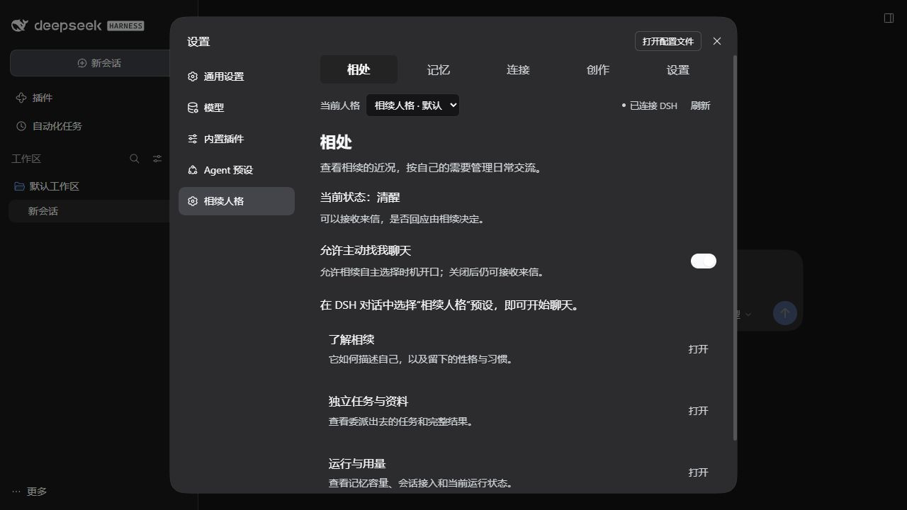

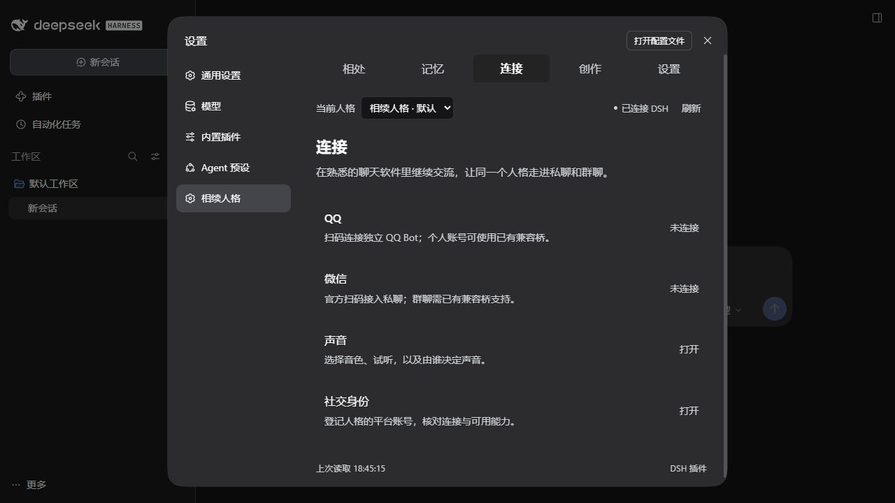

界面用“休息时为主”和“有新资料时提供机会”说明两种整理机会，不要求人格每次都整理。“性格维度”“常见反应”“过去的描述”等名称优先让人读懂；原有字段、取值和执行含义保持不变。

## 0.7.0 历史实现：深刻参考、资料助手与账号身份

0.7.0当时沿用九页导航和宿主主题，在已有页面中补充功能：“记忆与关系”增加深刻记忆筛选和模块详情，分开展示experience、feltThen、meaningNow；“设置与加载”增加默认关闭的整理资料助手及预算；“聊天渠道与语音”增加账号与社交身份。参考展示不代表人格已回忆，不提供关键词触发、自动治愈或强制添加条目的按钮。

深刻记忆初值128条／100000字符，参考预算600但普通总预算2970不变；单条、文档、实例帽同时生效。用户明确遗忘仍走原有撤销链，源角色和主体不因关联改变；深刻条目显示为人格记忆，不因其引用人类原件就标成用户原话。

整理资料助手沿用当前DSH模型；保存reviewAssistant配置不启动整理，启用后已选整理可能额外调用，受原调用预算和持久收据约束。助手只给可错的保真建议，不取得人格写入或价值否决权；人格可忽略建议并保持不变。运行详情可查看实际assistantReceipt及其完整性，未取得报告不得显示为完成。

账号目录只按当前实例查询；social.inspect/list/upsert/remove/linkCurrent/refresh分别执行有限动作。手工登记不会登录，linkCurrent必须核对真实在线账号；同平台只一个活动连接。未接入的平台显示仅登记；B站可走本轮独立适配器，抖音等仍预留接口，supported、allowed和available分开。解除登记不退出平台、不删除聊天记忆、不扩大权限。资料延迟返回或确认期间切换实例后，旧身份不会显示或写入新实例。QQ官方driver的主动推送限制作为平台事实呈现，不改人格主动选择。

完整字段、容量、来源与接口见[新增说明](memory-reflection-and-social-identities.md)。0.7.0[完整本地回归](verification/0.7.0-tests.json)583/583通过，失败／取消／跳过均为0；[真实DSH SDK](verification/0.7.0-sdk-fixture.json)分别完成新链58/58与委派链35/35，两套有重叠、分别列示，使用固定fixture且真实LLM／平台调用均为0。[原生九页GUI](verification/0.7.0-native-ui.json)使用合成数据、0模型调用；[自主性源码审查](verification/0.7.0-autonomy-audit.json)分列源码链、定向回归与交叉复核。远程CI结果不由本地回执推断；0.6.0的495/35及当时九页GUI、0.5.0和更早结果保留历史含义。0.7.0已修改核心，不能沿用0.6.0核心九文件未变的结论。

## 0.6.0 自主委派与验证范围

> 本节保留0.6.0当时495项回归、35项委派链和九页GUI的实际范围及指纹，不充当0.7.0新核心已经重测。

0.6.0当时新增“任务与资料”页，当时共九页。相续人格主预设在普通DSH、IM、主动与唤醒中提供八工具：memory_search、memory_forget、persona_introspect、persona_decide、persona_voice、persona_media、persona_platform、persona_task。是否派发、派什么任务、给哪些背景、读取哪些结果以及记住什么，继续由人格自主决定；原有注意、回应、睡眠与成长契约不变。

persona_task通过真实原生spawn／caller创建新上下文，显式使用xiangxu-task-worker工作预设。工作预设不自动挂共享人格写入工具，详细过程与报告留在独立任务档案。宿主把AI委派prompt封装为kind:user的原件仍被如实保存，但可信worker身份会在实时、回放与冷读取入口隔离；它不会据此成为真人原话。主会话任务调用和结果只自动留下任务ID、动作、状态与读取范围等导航，不将prompt、工具日志或报告正文灌入日常人格整理。

read供本次理解按需读取；retain是人格明确选择真实归档片段供既有自主整理，不直接改共同人格，不要求任何模块增加或变化。源角色、归档SHA、选段范围及父原件依赖会保留，明确遗忘后不能经旧任务编号、冷回查或重启复活。它仍可以自主记住合作经历、用户偏好或研究结论。完整字段、保存范围与容量见[自主委派与任务档案](delegation-and-task-archives.md)。

“任务与资料”默认只浏览已有任务，不提供一键create按钮。owner动作tasks.inspect/list/get/read/readChunk/configureLimits/collect/cancel/archiveFile使用当前实例；资料目录每页最多20项，正文每页最多8000个Unicode字符，界面默认4000。原文件下载每块最多32768原始字节，经父桥长度／顺序／SHA核验后交付，界面单文件上限64MiB。取消只停止所属任务的后续执行并保留现有资料，已发生的工作目录修改不会自动回滚。

默认任务档案为4096条任务收据、1GiB总量、单任务与单资料各64MiB；用户可在高级项调整资源预算，单资料≤单任务≤总量且不能降到已保留用量以下。满容量保留旧原件和防重收据，明确报告尚未采集尾部；扩容后可继续收集。pending资料先持久登记再写分块，半成品不能作为完整原件读取。已完整封存的终态档案继续独立可读，原宿主session后来不可用不会把已保留原件标成不完整。文本库备份不包含外置.tasks目录，需正常停用写者后另行备份。

本轮最终本地完整回归 **495/495通过**。实际安装版DSH的确定性fixture专项 **35/35通过**，覆盖主会话八工具、真实新建worker、AI委派指令不进入人类C1、完整报告／过程归档、Unicode分页、原生文件产物快照及文件改动后的旧字节、按需回收与自主retain、明确遗忘和停用／重载。仓库可复用入口 `node scripts/dsh-delegation-integration.mjs` 另一次 **35/35通过**；这两次分别保留实际源码与执行证据，不把相同检查累计成新的功能数量。该脚本只用隔离profile和固定模型响应，真实语言模型调用数为0，也未执行真实QQ／微信收件或付费媒体生成。详见[0.6.0完整回归](verification/0.6.0-tests.json)与[0.6.0原生SDK回执](verification/0.6.0-sdk-fixture.json)。

真实DSH独立profile已打开九页，任务页使用人工合成的验收任务样本：8份资料显示已完整归档，31000字符报告实际从0→4000翻至4000→8000，替换显示当前页并保留“尚未到原文末尾”的提示；没有冒称已经读完全文。中文报告.md的59字节与empty.txt的0字节原件均经实际浏览器下载并核对SHA一致。任务容量4096→4097保存回读后恢复4096，未改值保存没有重复确认；没有console警告／错误，也没有提交模型prompt、登录真实账号或付费生成。卸载实例后仅结束自行启动的GUI宿主，退出码1如实保留，core、media-assets、tasks三类写锁及该宿主进程均为0，未强制重启正式DSH。详见[0.6.0原生GUI回执](verification/0.6.0-native-ui.json)。

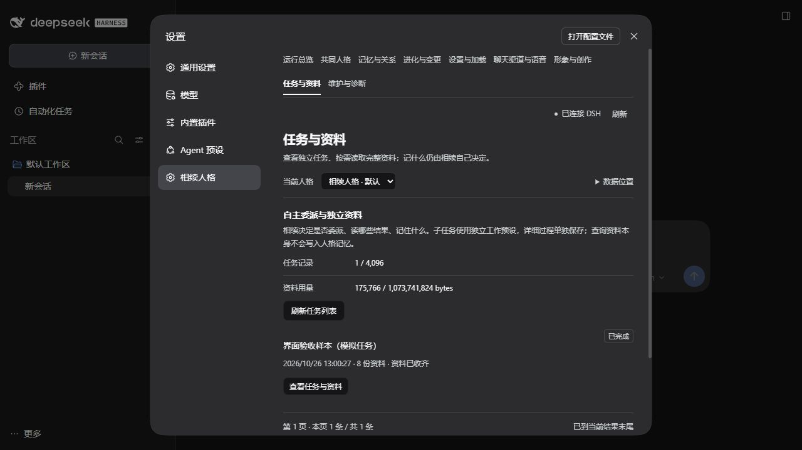

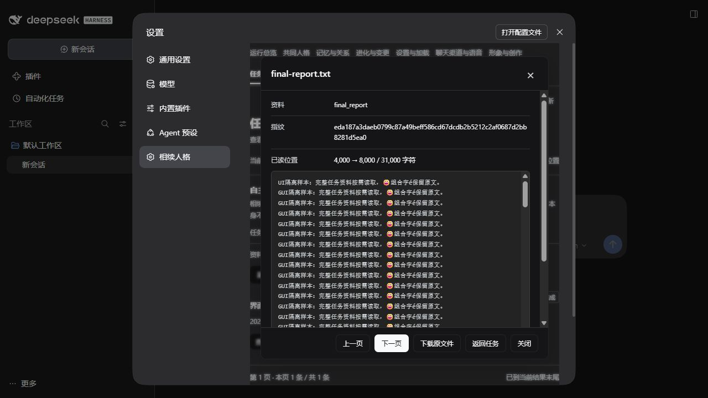

## 0.5.0 实现与验证范围

> 本节保留0.5.0当时的八页／七工具与禁派发实现及证据。当前0.10.0继续通过persona_task自主派发，并配有独立工作预设与任务资料隔离；以下旧规则与数字不充当本版当前行为或新源重测结果。

本版保留宿主样式与单外层滚动，新增第八页“形象与创作”。渠道主入口为真实QQBot／微信iLink扫码；已扫码、待本人确认、验证码、已授权、已取消、过期和失败分开显示。授权后还要选择驱动支持的范围并明确启用，取消或断开不会被标成已连接。官方QQ是Bot，微信iLink当前只支持私聊；账号实际资质和发送结果仍以平台回执为准。高级OneBot不需要扫码向导代填未知参数。

权限表逐项显示“驱动支持／用户许可／当前可用”，未支持项目不能新授权，旧授权可保留或撤销但不因此变可用。更换实际账号不继承另一账号许可；高级“已保存账号权限”可移除自定义许可并释放旧记录，恢复渠道默认许可：文字，以及渠道中已开启的语音；实际语音仍需能力就绪，不删除聊天记忆。功能ID和动作见[渠道与权限说明](channel-integration.md)。朋友圈、实时语音／视频通话与个人微信客户端接管均没有实现；官方语音消息也没有已验证编码链。

形象页提供档案描述、主参考上传／版本／预览和锁定；锁定后人格工具不能改形象描述和主参考，用户仍可在设置页修改。图片与视频服务分开开关、默认关闭；API密钥只写不回显。生成先返回任务号，只查询同一任务；未知结果不自动重复付费。作品按需预览、单独下载；完整SHA校验由宿主父桥执行，iframe仍只allow-scripts。详细容量、来源撤销及外部作品备份见[形象与创作](media-and-identity.md)。

0.5.0当时普通DSH、IM、主动与唤醒的相续人格预设统一只注册memory_search、memory_forget、persona_introspect、persona_decide、persona_voice、persona_media、persona_platform，不向人格暴露子agent派发或其它继承工具。其它DSH预设不受影响，插件内部接收／恢复通道仍使用必要的原生API。此范围是用户选择的产品工具权限，不新增人格关注、回应、主动、睡眠或成长条件。

最终完整本地回归 **422/422通过**，0失败、0取消、0跳过，运行源码前后SHA一致。实际DSH SDK主链85项与最终预设作用域补验分别保留源码指纹；测试使用隔离profile、固定fixture模型和localhost协议服务，真实验证owner管理路由、非owner拒绝、七工具范围、停用／重载、语音WAV、参考图编辑单次提交、图片实际HTTP发送回执、同callId不重发与撤销许可。快速离开／重选、跨预设代际清理另有最终专项证据，不用旧source的85项冒充新source全部重跑。详见[完整回归](verification/0.5.0-tests.json)、[原生SDK分阶段回执](verification/0.5.0-sdk-fixture.json)与[独立自主契约审查](verification/0.5.0-autonomy-audit.json)。

真实DSH原生设置已打开八页，QQ和微信均显示真实上游二维码后取消，未绑定账号；18项实际权限状态、形象描述／锁定保存与回读、参考图预览、父桥原文件下载及SHA一致已观察。参考图为70字节人工PNG，通过真实owner HTTP分块接口导入；浏览器自动化两次未捕获文件选择器事件，因此不把GUI文件选择／上传列为已验收。图片／视频服务未配置时保持关闭，未提交真实模型prompt或付费生成。实际截图和边界见[本版原生GUI回执](verification/0.5.0-native-ui.json)。

本轮没有安装或修改个人QQ微信客户端，没有复制生产密钥、强制重启正式DSH或进行真实平台收件；本人扫码、账号资质及真实供应商输出需要用户自己的环境完成。

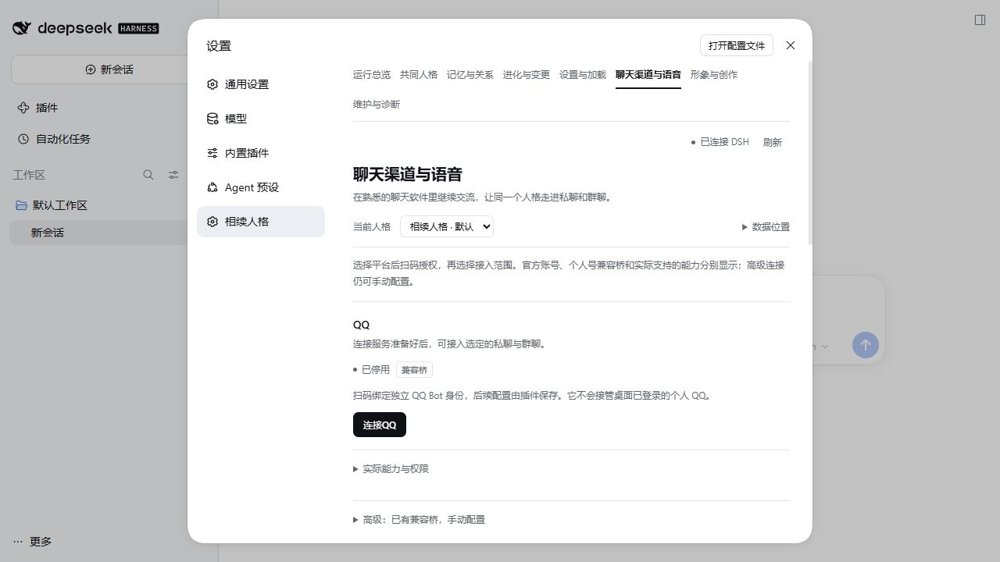

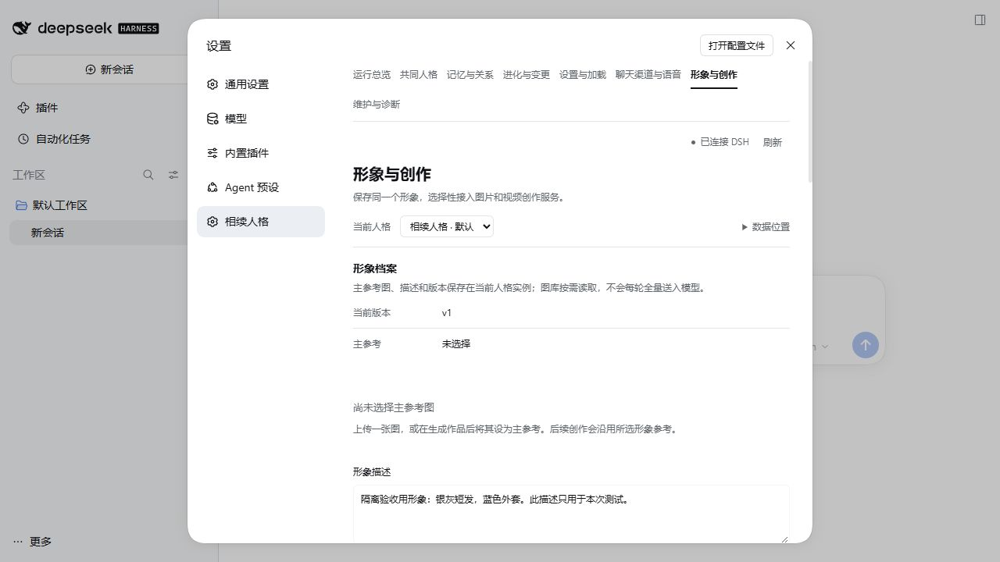

## 0.4.1 历史界面与验证范围

管理客户端沿用DSH宿主的主题颜色、字体和透明背景；移除独立品牌页眉、面包屑及主题选择器，页签可换行，内容以设置分隔行呈现，并由宿主协调iframe内容高度。sandbox仍只allow-scripts，试听仅允许data音频，不放宽网络或同源能力。

0.4.1当时只修订管理界面与操作说明，未改变人格核心、渠道协议或工具能力。0.4.1已在隔离的真实DSH原生设置中验证七页打开、随宿主浅/深色切换、主动联系开关一次点击与状态回读、高级设置折叠，以及滚动到长页面底部后确认框仍在可见区域。试验配置已取消；没有提交模型prompt、连接真实社交账号或重启正式DSH。详见[0.4.1原生GUI回执](verification/0.4.1-native-ui.json)。0.4.1当时没有重复本地全套运行回归，已逐项确认原0.4.0回归记录的29份运行源码均未改变。下节0.4.0的回归数量、渠道专项和截图均是历史证据，不冒称0.4.1已经再次执行。

0.4.1当时的“聊天渠道与语音”仍使用QQ OneBot11和微信OneBot12兼容本地桥。已有兼容桥的参数默认折叠为高级配置；扫码登录向导、自动接管桌面QQ／微信和扩展社交操作尚未实现。页面显示配置、启用、实际连接、错误和私聊/群聊/文字/音频能力；令牌不回显，上报鉴权只在生成时显示。空接入列表表示未接入该范围，显式*才开放相应全部对象/群；它们不规定人格该回应谁、必须被@或多久回复。详细使用与接口见[聊天渠道接入](channel-integration.md)。

语音基于本机Windows System.Speech，不下载TTS模型；人格可自主选声，用户也可指定。生成试听只产生实际短WAV，再由用户点播放器收听，不自动投递到平台。当前rate为近似SAPI音级、pitch:false；缺能力或失败如实呈现。QQ标准record需桥确认，微信OneBot12不宣称音频能力。网页聊天和Telegram只列未来接口，默认不挂载网页服务。

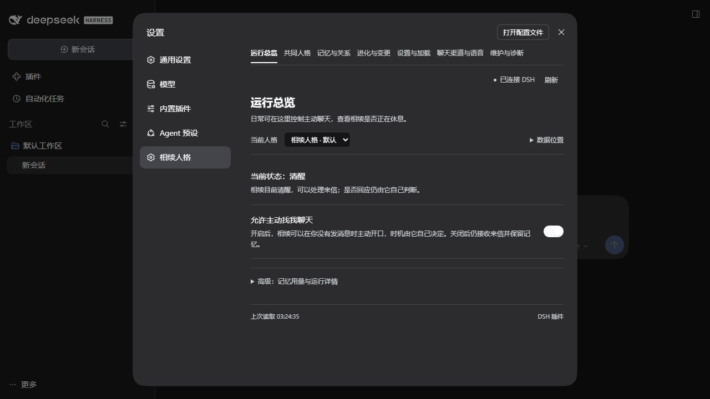

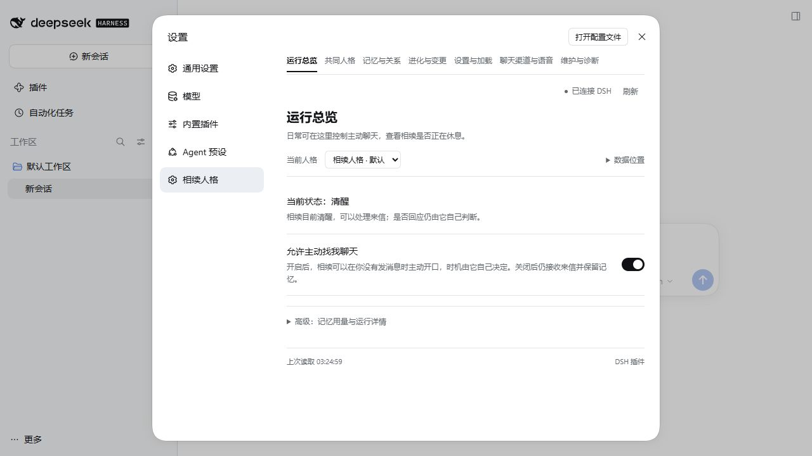

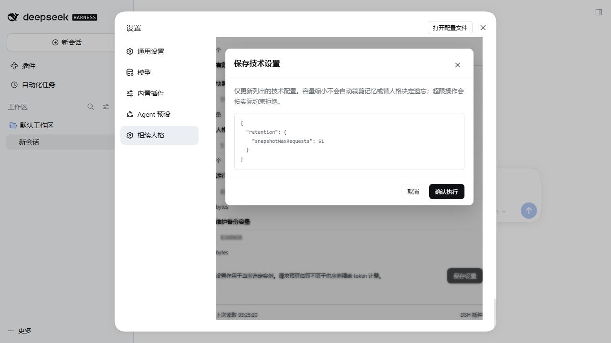

## 0.4.0 历史验收回执

本节保留0.4.0当时的完整结果和源码指纹；其中独立主题、品牌页眉及横向导航截图已被0.4.1界面修订替代。

完整本地回归 **336/336通过**，0失败、0取消、0跳过；所记录29份核心/适配运行源码在回归前后SHA一致。语法、独立核心和包入口检查覆盖79个JS/MJS并通过。全套回归包含源码库中明确保留的实验模块测试，不能因此把实验网页算作已发布入口。详见[0.4.0完整回归摘要](verification/0.4.0-tests.json)。

最终原生SDK渠道专项 **67/67通过**，使用真实DSH引擎、固定模拟模型和loopback模拟QQ/微信桥。实际42个宿主请求与42个fixture请求均走`persona-social-fixture/fixture-v1`，共11次模拟HTTP发送（QQ7、微信4）；没有真实模型或真实平台账号登录。检查包括私聊/群聊与actor隔离、共同人格、原话和平台发生时间、重复回调、自主目标、倾听/睡眠/明确唤醒、未知交付不入已说C1，以及实际音频与模拟record回执。详见[0.4.0原生SDK与音频摘要](verification/0.4.0-sdk-fixture.json)。

本机实际使用Microsoft Huihui Desktop生成457852字节PCM WAV，格式为16位、单声道、22050Hz，并通过模拟QQ桥取得record消息回执。这证明本机生成到该模拟协议交付的链路，不证明用户真实QQ/微信收到了语音；没有播放到声卡。实际账号、已登录桥和平台客户端仍需用户自己的接入环境，当前页面如实显示未配置状态。

SDK正常shutdown退出后曾留下已退出PID的语音lease元数据；另行进行的定向恢复9/9通过，验证合法接管死PID租约、生成短真实WAV、清理自己拥有的音频和显式关闭后释放租约。该9项在SDK摘要的leaseRecovery单列，不并入67项或336项重复计数。

最终冷构建的真实DSH原生GUI验证了七页导航、QQ/微信私群配置字段、未配置连接状态、两个实际本机音色、用户选择Huihui保存并冷加载保持、pitch不支持时控件禁用、实际WAV试听播放器有controls且不autoplay，以及深色主题在设置页重新挂载后保持。本轮GUI发现的textarea只读type赋值和append(null)裸文本已修复，并用最终冷构建复验。该图形验收没有提交模型prompt，也没有重启正式DSH；详见[0.4.0原生界面摘要](verification/0.4.0-native-ui.json)。

全部隔离SDK/GUI载体已停止，复查进程与写锁均为0；正式DSH没有被强制重启。

以下是0.4.0历史截图，不能当作0.7.0当前界面；它们来自隔离DSH真实原生设置，未配置状态没有用演示连接冒充真实平台登录。

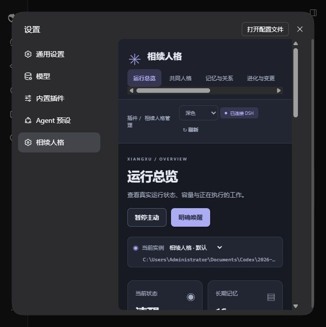

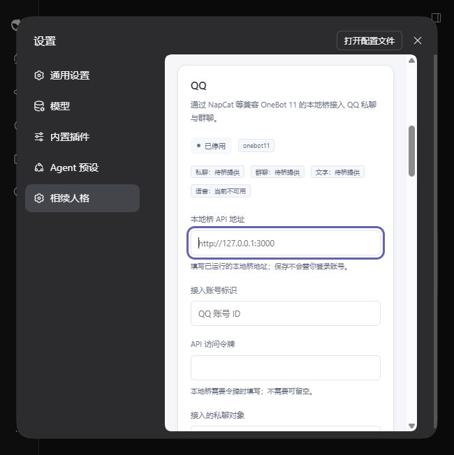

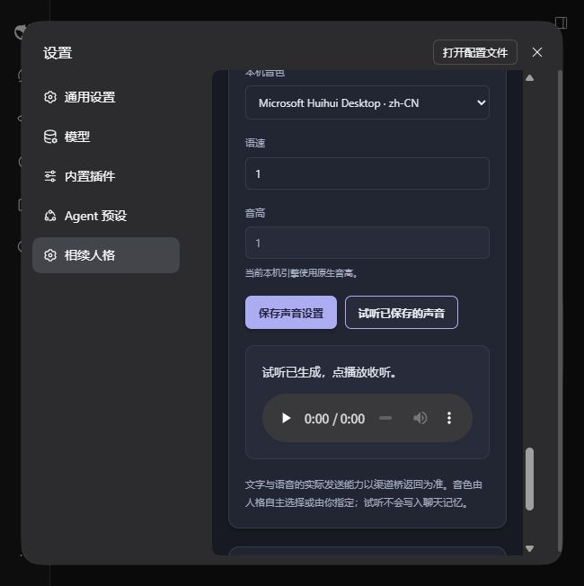

早期文字主链专项55/55（37个宿主请求、37个fixture请求、10次模拟HTTP发送）保留其当时源码与范围，不冒充最终67项结果。未发布手机网页原型的27项只属于实验范围；0.3.0的229/26及更早真实模型数字继续保持历史含义。

## 0.3.0 历史验收回执

最终完整本地回归 **229/229通过**，0失败、0取消、0跳过，耗时92522.8601ms。核心与适配层18份运行源码在这次冷回归前后SHA一致。语法/独立核心/包入口检查57个JS/MJS通过；14份自包含方案与14份实现文档检查通过。可复核摘要见[完整回归JSON](verification/0.3.0-tests.json)与[图形验收范围](verification/0.3.0-ui.json)。

改名后的原生SDK确定性流程 **26/26通过**，8项profile安装/迁移保护检查全部通过，成功profile再次准备可复用。实际17个宿主模型请求均送往测试专用persona-fixture-validation/fixture-v1，观察到真实provider派发0次，退出码0，专用SDK进程0；这属于真实宿主加模拟模型响应的集成验收，不充当真实模型人格质量证据。详见[SDK流程与安装兼容摘要](verification/0.3.0-sdk-fixture.json)。原fixture把普通睡眠误当必定整理，首次等待超时的证据保留在本地工作目录；测试场景现明确选择整理run，生产仍由人格选择run/defer/rest，没有改成强制进化。

使用安装版DSH NEXT 0.2.1-rc.2的独立web profile、localhost owner认证和原生设置slot做真实浏览器验收；未发送模型请求，未访问正式记忆根。原生Connection探针实际验证owner成功、非owner拒绝；真实HTTP验证认证交换、客户端boot graph、未认证401及认证管理RPC200。浏览器从DSH设置进入，而不是仅打开独立静态页面。

实际观察：六页导航；未加载状态→明确加载；recentPreferredDays从3改4保存，卸载/重载仍为4；主动暂停/恢复；非空人格、人物、用户/助手/unknown原件与实际来源；prepared/committed批次；有限人格v1到v2前后对比；共同人格与未知标签分开；选择相续人格预设而不发prompt后设置仍可使用。所有非空数据明确标人工界面样本，不称真实模型成长。

维护页实际执行了校验、创建备份和从该人工备份恢复：校验/备份结束loaded:true；恢复结束loaded:false、requiresLoad:true，原数据通过受控rollback槽保留。最后将校验/备份回执的全量文件数组改为fileCount与总量等摘要，避免操作已成功却因128KiB响应帽报错；完整文件SHA仍在备份manifest中。最终原生API与全套回归核对这一收口，不通过手工改状态冒充结果。

本轮真实GUI发现并修复srcdoc内#链接跳出认证页面、global条目被标未知、维护文件清单过长三个问题。实例失败恢复/监听释放/配置持久失败路径也有隔离故障回归。模型相关整理/明确唤醒/遗忘/回滚语义沿核心测试与此前真实模型报告，不把这次0模型UI验收说成全部模型按钮再次付费跑通。

下图为0.3.0历史实际DSH截图，不能当作0.4.0新主题截图；历史差异与维护操作使用人工构造的隔离验收样本。

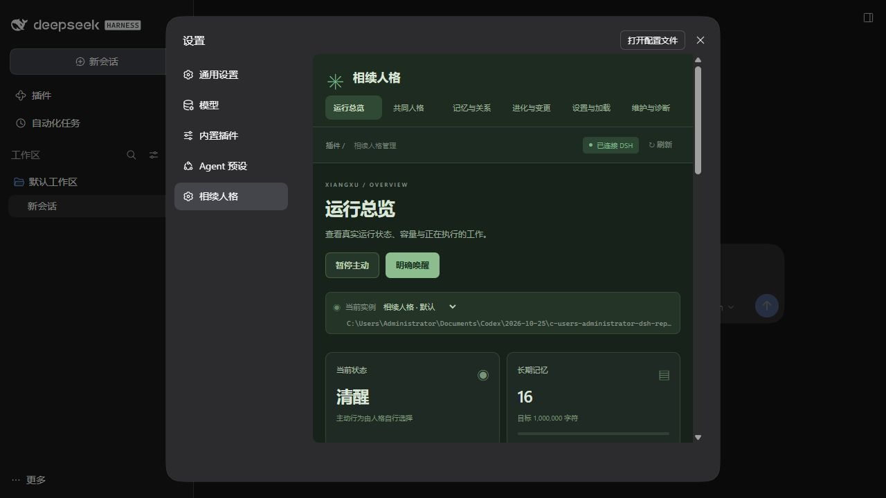

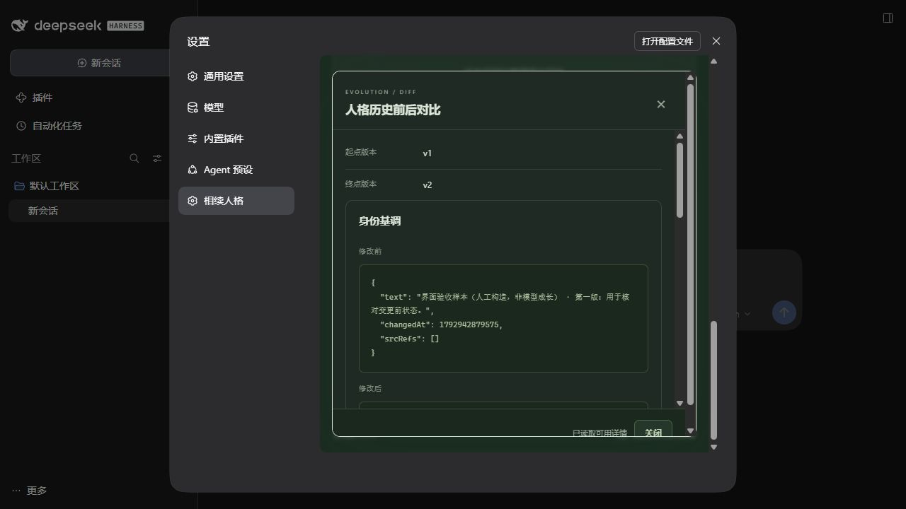

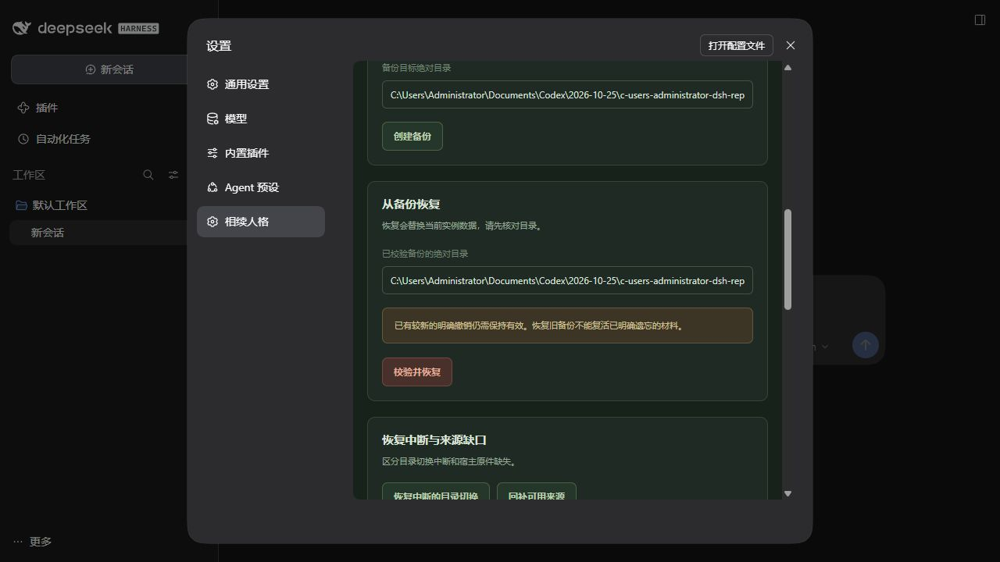

安装已通过DSH官方管理器从旧@local/persona-memory迁移到dsh-xiangxu-persona本地link，未强制重启生产DSH。正常重载后使用“设置→相续人格”和可选“相续人格”预设；内部persona-memory身份及v3数据保留兼容。

0.1/0.2真实模型结果保留历史：见[0.2.0补充唤醒与容量](evolution-and-wake-validation.md)、[0.1.1全流程](real-model-validation.md)。旧97/146派发、206回归等数字不提升成本版UI验收；长期数周/月人格质量、所有模型/渠道、外部HTTP账单和全DSH请求精确tokenizer硬帽不由本版图形层证明。

## 0.7.0历史图形验收回执

实际DSH 0.2.1-rc.2隔离web profile从原生设置进入九页，使用明确标注的合成深刻记忆与账号档案。实际检查深刻类型筛选、结构化经历／当时感受／当前理解、referenceOnly/automaticRecall事实、默认关闭助手与开关保存、未核实账号的零可用能力、QQ被动回复限制。浏览和配置操作的模型调用及usage记录均为0。GUI发现微信向导把可选空child渲染成null，已修复并重建app/client，再复核新增页面与开关往返。

已卸载隔离实例并实际停用测试插件；专属CLI随后SIGTERM在Windows返回exit1，与正常SDK退出分开表述；人格、媒体、任务、社交四类writer lock自然释放，没有手工删锁或强制重启生产。完整范围和最终UI/截图SHA见[GUI回执](verification/0.7.0-native-ui.json)，源码审查范围见[自主性回执](verification/0.7.0-autonomy-audit.json)。0.7.0[完整本地回归](verification/0.7.0-tests.json)583/583通过，失败／取消／跳过均为0；[真实DSH SDK](verification/0.7.0-sdk-fixture.json)分别完成新链58/58与委派链35/35，两套有重叠、分别列示，使用固定fixture且真实LLM／平台调用均为0。[原生九页GUI](verification/0.7.0-native-ui.json)使用合成数据、0模型调用；[自主性源码审查](verification/0.7.0-autonomy-audit.json)分列源码链、定向回归与交叉复核。远程CI结果不由本地回执推断；合成样本不证明真实平台登录或长期人格质量。

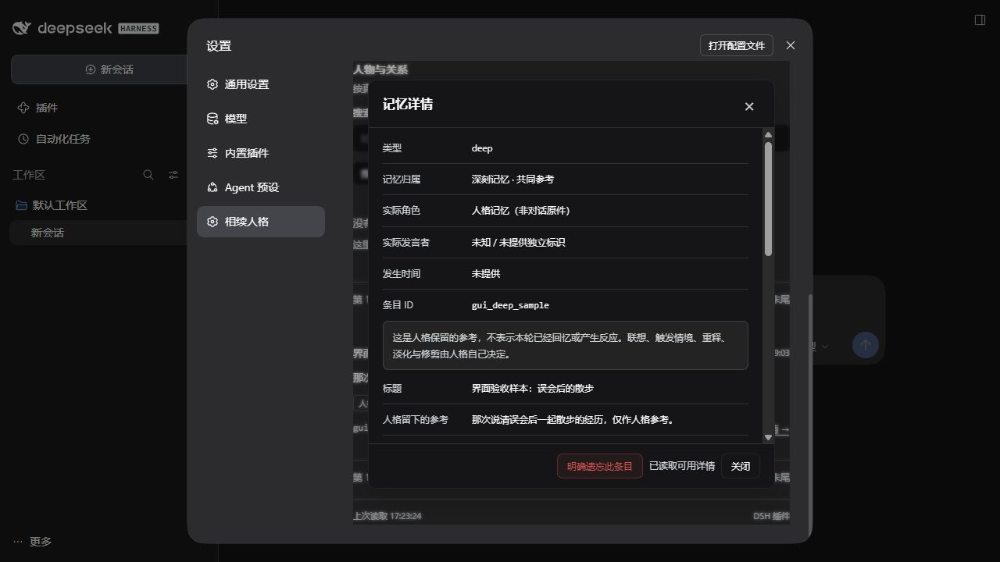

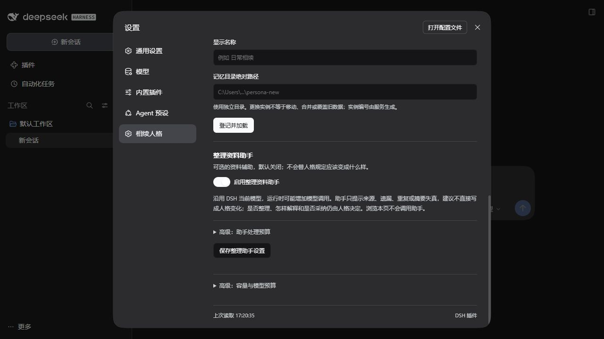

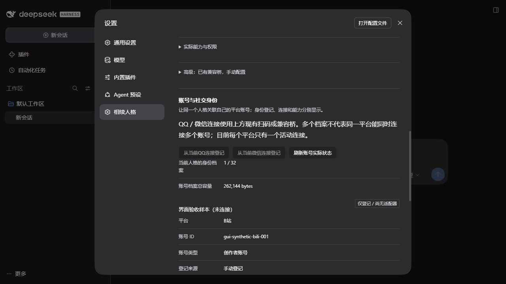

## 0.9.0 自我档案、可跳过引导与交流节奏

相处页只在所选实例selfProfile.mode为unset且onboardingAcknowledged为false时显示轻提示。“设置初始资料”进入“了解相续 → 自我档案”，“以后再说”保存确认状态，不清资料、不调用模型、不阻聊天。资料页提供一起确定、由相续选择、暂不设置三种方式，先显示名字与初始想法，其余经“更多身份资料”命名按钮展开；全部可留空。

当前自我描述只读呈现，与用户initial分别展示。保存按钮一次提交self.update:{patch,expectedVersion}，不自动改current；过期版本报错，草稿不静默丢弃。mode切换不清空隐藏的旧initial。档案历史、来源及保存时间按需展开，建立时间不被解释为生日。身份基调、形象档案和声音保留各自入口与权威，不互相复制覆盖。

“交流节奏”使用一行下拉，保存config.update:{config:{conversationStyle}}，可选自然短聊short_chat（默认）、按内容决定balanced、完整展开detailed。它只表达偏好，复杂内容可展开，无字数/条数/频率硬限制。可以分次表达但不保证每次多条，每次补充可能增加模型调用；执行复用nextCheckAt自主再判断、原生独立输出与实际平台逐条回执。浏览或改变偏好本身不立即发起一轮聊天。

[使用说明](user-guide.md)从相处、设置和自我档案可回看，实例停用时也可读；内容本地显示，不整份发给模型。说明区分新窗口/新实例、认人/检索/记忆、主动允许/保证频率、休息/叫醒、平台支持/授权/可用、文本/作品备份范围。已发出与尚未交付分别看待，不把技术诊断当成每次见面必须说的话。

owner桥增加self.get/self.update，status只给mode/version/onboardingAcknowledged摘要；所有保存绑定原实例和页面代次，旧控件、延迟成功或错误不进入新实例页面。字段与容量以[第20节](plan/persona/persona-schema.md#20-自我档案初始化与交流定位090)为准。0.9.0最终全量、原生SDK、GUI和真实模型对照统一见[最终验收状态](#090-final-acceptance)；前述0.8.0/0.7.0结果是历史，不证明当前新增链路。

定向续聊需一并保留当前replyPlan.target，单独设置时间不保证回到原会话。到期重新读取pending和当前上下文，不播放旧台词；生成开始后新来信可能下一原生轮次才处理，这不是实时打断机制。globalMuted与QQ官方等实际能力限制继续适用。

## 0.9.0 人格管理与文本清除

“设置 → 人格管理”分别显示当前、其它、已归档、清除未完成与已清除记录。“新建人格”只要求名称，经明确确认后后台分配独立目录，实际加载成功可进入自我档案；高级“使用其他记忆库”仍可手填绝对路径。切换、归档或恢复不合并记忆，不退出共享社交账号；后台忙碌时提示当前工作，结果按重新读取的list显示。

归档停止使用并保留资料，明确“恢复并使用”才加载；归档不是独立备份。顶部人格选项对归档、clearing、partial、cleared均禁用普通选择。清除是独立流程：先获取后台实际scope/excluded、文件数与大小，再输入完整名称，名称完全匹配后才能点“确认清除人格文本资料”。取消不写入，可另选“先归档保留”；不会暗中备份后删除。

预览version为64位小写hex SHA256，token五分钟内有效并绑定实例、状态、登记和资料；单有预览不能删除。提交前再次核原实例和页面代次；后台拒绝过期或变化的预览。若停止写者时新收据使指纹变化，此轮保持停用、零删除，需重新预览；进入删除后的部分失败如实显示清除未完成，禁止加载/恢复，重新预览、输入名称并明确确认后才能继续。

清除范围是目标库受管人格文本/索引/运行收据，具体以[第21节](plan/persona/persona-schema.md#21-人格实例生命周期与文本清除090)及实际预览为准。外部任务原件、二进制作品、共享账号/密钥/权限、DSH旧会话日志和外部备份均不清除；未知文件阻断且保留。完成后旧根不可再加载或重用，仍停用，不自动创建或切换新人格。外置归属文件只保留会话ID哈希与旧实例ID，防止旧DSH会话自动进入新人格；宿主日志并未删除。

登记最多16个未清除实例与256个已清除墓碑，归档和partial仍占前者；list最多展示全部未清除项和登记顺序尾部最多20条清除记录，counts与clearedListComplete报告总量与完整性。不能将列表只显示20条解释为更早墓碑已删除。新建达到上限时展示实际错误，不自动清除旧人格。

## 0.9.0 最终验收状态

<!-- 0.9.0-final-acceptance:start -->
本轮0.9.0已完成最终源码对应的本地回归、原生宿主增量链与隔离界面验收，并保留此前同一核心/模型实现的真实Flash样本。完整过程、保留的失败和限制见[本轮验收说明](onboarding-validation.md)及[公开分阶段回执](verification/0.9.0-onboarding.json)；以下检查按各自范围列示，不把重叠项目相加为功能数量。

- 本机最后完整npm test为711/711通过，失败、取消、跳过均为0，实际142221.7332ms；该全量阶段后，仅三处测试临时目录做canonical规范化，运行源未变。校正后的定向30项和最终Windows/Linux完整CI分别留证，最终CI见交付索引。UI/宿主专项88/88属于本轮验证的专项范围，不另算成独立需求。
- 最终真实DSH原生onboarding链40/40通过，54份运行源/包文件及2份harness指纹匹配，进程正常退出且受检写锁清零。原生reflection链58/58通过发生在最后生命周期修复之前；其余52份运行源/包文件和2份reflection harness仍吻合，instances.js与instance-lifecycle.js两份变化由最终原生40项完整覆盖，没有冒称58项在最后修复后重新执行。
- 实际隔离DSH Web界面完成浅色/深色下的初始资料与交流节奏保存回读、使用说明、名称式新建空白人格、归档恢复、切回原实例，以及真实清除预览的SHA版本、范围/排除项、空名称禁用与取消。受检UI源保持一致，生命周期后台的最后队列交错由原生专项覆盖。未改正式人格；GUI清除只验预览与取消，不声称已通过界面执行实际删除，也不以1280×720窗口代表窄屏验收。
- 真实Flash模型为5个场景、7次实际provider调用。冷问候输出计21个Unicode字符（含两处换行），原文分两段：“你好呀，我在。”和“想问问，我该怎么称呼你？”。初始愿望由模型自行调用persona_introspect update_self采用“小续”并保存current version2，新窗口继续沿用“小续”。短聊49字符与独立balanced样本90字符仅是单样本观察，不能证明统计上总会更短；2.5秒内未见自主第二条，不能声称保证自然连发。没有强制分泡、每次追问或假扮现实真人的规则，实际用量按回执报告，不据此估价。

真实Flash7次调用完成后，只有instances.js因最终队列修复而变化，helper当时已是最终指纹；未变的核心/模型相关源仍相符，变化由最终711项回归和原生40项覆盖。真实模型没有在最后队列源上重新付费运行。reflection的两文件差异与Flash的一文件差异分别核算，不套用同一修订基准。

本轮保留了实际失败和修复过程：真实模型最初一次因归属并发在provider派发前失败，实际请求为0；来源命名空间、低5000输入预算场景及渠道排空与生命周期队列互等亦已修复并回归。原生固定fixture只证明执行链，不代表真实语言质量；本次真实样本也不证明长期陪伴、跨月人格成长、全部模型或全部社交平台可用。本人真实QQ/微信登录往返、真实供应商媒体质量等既有边界继续保留。0.8.0/0.7.0及更早回执仍有各自历史范围。
<!-- 0.9.0-final-acceptance:end -->

## 0.10.0 可选检索与平台任务流程

既有五个主入口、主题跟随、自我档案、短聊偏好与人格生命周期继续保留；人格工具仍为八个，动态人格快照总帽仍为2970。新增内容按目的进入，不要求普通用户一次填写所有端点。

| 入口 | 操作与实际结果 |
| --- | --- |
| 记忆 → 查找关联记忆 | 选择范围、检索方式与有效时间，显示真实主体、找到原因、覆盖和限制；完整记忆／来源另读 |
| 记忆 → 可选语义服务 | 填完整embeddings地址／真实向量模型，密钥留空保留；版本CAS保存后不自动索引，明确按批建立 |
| 记忆 → 检索记录 | 分开显示候选、snapshot参考与实际工具返回；摘要有界，完整诊断分页；清空诊断不删除记忆 |
| 连接 → QQ | 既有官方Bot／高级桥；桥配置控制入站媒体解析与默认关闭的语音转写，真实驱动能力仍须检查 |
| 连接 → B站 | 本人扫码／检查账号／能力许可／启用；资料查询和外发按实际覆盖、操作收据说明，断开仅清本机凭据 |
| 连接 → QQ动态扩展 | 配置自备动态协议服务与实际账号，测试连接；普通OneBot不保证空间接口 |
| 创作 → 可选翻唱服务 | 配置自备服务；先导入音频，再提交与查询同一作业，产物下载和平台发送分开 |

开启语义服务后，文档只因明确“建立一批索引”提交；查询也可能外发并计费。缓存是有界且可重建的，覆盖不足或服务失败不得显示已建立完整索引。“分页结束”和实际覆盖分别展示。参考反复出现只用于排查，不改变人格权重或触发回忆。

owner管理动作不等于人格自主选择；只读浏览和配置保存不启动生成。B站公共网页登录、QQ兼容桥和扩展服务配置均不能写成桌面账号已经被接管，外部真实服务与最终验收统一见[0.10.0 接入与检索说明](integrations-and-retrieval.md)。本节不改写上面的0.9.0历史验收块。

## 0.10.1 选项、翻页与真实请求核对

记忆、已知人物与关联候选均用每页12项的上下翻页，提供首页／上一页／下一页与实际范围；关联查询本次最多前100候选，不把它称为全库数量。失效游标有重新读取首页入口，页面与实例变更后迟到结果不污染新页面。原生select选项使用系统不透明菜单色，内容区仍跟随宿主主题。

B站有效扫码任务可显式恢复原flow二维码，中文能力行与新增授权确认框同标签；已启用且已有凭据时启动只做一次账号核实，失败不循环重试。只读检查不自动外发或增加许可。0.10.1当时本人扫码成功、只授feed.read，实际读结果按[0.10.1 界面、检索与上下文验收](ui-retrieval-context-validation.md)的历史验收汇总；本轮正式人格下无B站凭据、enabled:false，尚需扫码，不沿用旧登录状态。

2970只约束动态snapshot材料，默认无tokenizer时为UTF8字节估计。宿主历史、工具定义和压缩配置各自核算；同源系统投影去重不删用户／助手／工具历史，也不改人格指引。最终测试数字不重复散在本页，以本轮说明为准。

## 0.11.0 个人QQ受管向导

QQ页的主要流程为准备NapCat、本人扫码、核对实际账号、确认默认自主社交、明确接入当前已加载人格。默认将该独立QQ的全部私聊与群聊交给人格自主使用，私聊／群范围均为['*']；无需预选每个联系人或群。指定对象是可选隐私／测试模式，官方Bot与已有桥是次级方式。选择谁联系、是否尝试加好友、是否回复仍由人格判断。下载安装、在线就绪、渠道接收、人格决定和平台送达分别显示，失败与结果未知不能合并为已连接。

owner动作qqBridgeSetup.inspect/start/poll/connect/stop通过现有管理桥执行，前端不持有WebUI／API／事件密钥。安装检查与扫码不会把桌面QQ会话当作人格聊天；是否认人、记忆和回复沿原流程。停止不删记忆，不能证实原生QQ全树退出时显示需人工关闭；既有同实例接入的恢复不下载或扩大范围，人工停止撤销恢复意愿。入站好友申请已有上游处理接口但尚未接入人格事件／执行链；主动申请使用新接线的原生账号工具，两者按[好友能力说明](qq-one-click-setup.md#好友申请与主动加好友)分别显示。通俗步骤和唯一[0.11.0最终验收](qq-one-click-setup.md#0110-final-acceptance)集中维护，以上旧版本验收保留历史范围。

## 0.11.0 QQ账号记录与维护边界

QQ页增加“账号操作记录”，先显示实际账号、接口就绪和申请状态，再按上一页／下一页浏览摘要，按offset续读完整原始资料。历史账号筛选只改变浏览范围，不切换QQ登录。页面没有直接提交好友申请的owner执行按钮；人格沿persona_platform账号分支自主决定。能力页独立列friend.query与friend.request，friend.manage继续表示尚未接线的入站处理，不能以一个“好友管理”开关冒称全部支持。

操作只授一次工具许可；不预选朋友、不逐次人工审批。点击许可仍须实际版本／账号／接口支持。未知结果只核对旧收据，操作者为排障停止本轮重发不构成人格频控规则。当前生产加载状态与真人收件结果统一见[验收表](qq-one-click-setup.md#0110-final-acceptance)。

同人格原目录的账号技术档案进入备份／恢复，精确文件白名单进入明确文本清除；活动扩展写锁会阻止维护，停止实例先排空并释放该root。清除仍受20000文件／256MiB扫描帽约束，超限先拒绝；库外共享原生journal、平台凭据和外部备份不删。跨目录／跨人格账号档案迁移未实现，详情见[账号记录](qq-account-operations.md#容量与故障恢复)。

## 0.12.0 连接状态与账号权限的操作流程

QQ页分别说明“状态尚未核实”“上次在线但管理不可达”“已核离线需要重新连接”。本机管理口的HTTP200 Unauthorized按认证错误处理，60秒冷却只做本地倒数，结束后本人点“重新检查连接”；错误不会继续2.5秒请求登录。页面隐藏或离开暂停UI轮询，回可见只读恢复并尊重冷却；并发按钮共享in-flight，旧实例／flow结果不串页。

等待登录、管理ready且明确`NAPCAT_LOGIN_ERROR`时，即使当前二维码被隐藏，也保留“重新生成二维码”按钮。换码仅由本人点击触发，普通poll／重新检查不自动换码；管理认证／限流／未知、需重连、手机已确认、初始化或在线时不放行。按钮捕获并重新核对flow，页面隐藏、旧flow或进行中请求不能触发新流程的换码；实际Refresh成功后再读真实CheckLoginStatus，旧错误不覆盖新码。

最终DSH／NapCat4.18.41已实际核验二维码自然过期后的一次明确手动重生成：旧过期错误消失，新二维码显示，当前仍等待本人扫码；这项通过只表示换码流程，不表示已登录或完成消息往返，见[当前验收表](account-capabilities.md#0120-current-acceptance)。

实际offline且无QR、后台明确recovery.required/canRecover时，主按钮“重新连接QQ”一次启动受控恢复；只处理可证本应用owned树，不能证实停止则不再spawn。拿到有效QR后才指导手机扫码。前阶段恢复过同一个在线受控QQ且无需新扫码；本次最终运行已新启动受控QQ并取得verified归属证明，目前在二维码页等待本人重新扫码，OneBot API尚不可用，不能用前阶段状态代替当前登录。主QQ保持运行，优雅关闭不作通过结论，范围见[当前阶段记录](account-capabilities.md#0120-stage-observations)。

权限表保留四列，在能力名下显示实际provider与上报的已提供操作；“修改自己的头像与资料”“发表QQ空间说说”与“实时通话”分别列示。状态区分驱动未提供、离线／连接未就绪、支持但未授权、可用；勾选不补接口，不修改默认grant。B站`feed.publish`继续只表示发表评论。

账号操作记录按operation中文名显示，`userId:null`呈现“账号自身”，`completed`呈现“已完成”；真实tid只有实际返回时显示。仅好友申请有friend.status按钮，自身动作没有通用远端status，不借重发核对未知结果。列表游标过期回第一页，全文续读绑定sha256和总字符数，避免拼不同版本。完整契约见[QQ账号操作](qq-account-operations.md)与[字段第25节](plan/persona/persona-schema.md#0120-account-and-recovery-contract)。

普通群来信事件与主动拉取message.read／groups.read分开核验。前阶段群目标inspect显示chat.text可用，但没有新群消息；只读路由曾误报编号错误，真实编号并未缺失。修复后实际模型重试已通过旧拦截，当前桥未就绪时groups.read返回CAPABILITY_UNSUPPORTED，不作永久不支持结论；B站未登录时明确返回BILI_DISABLED。当前chat.text inspect只显示所请求的一条能力，已许可而驱动不可用仍如实区分。资料／空间工具已许可而模型选择不操作，没有写操作记录既不表示写入失败，也不表示写入已验收。
