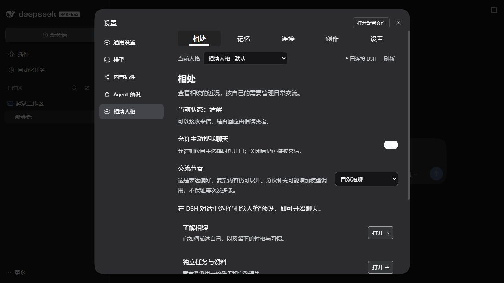
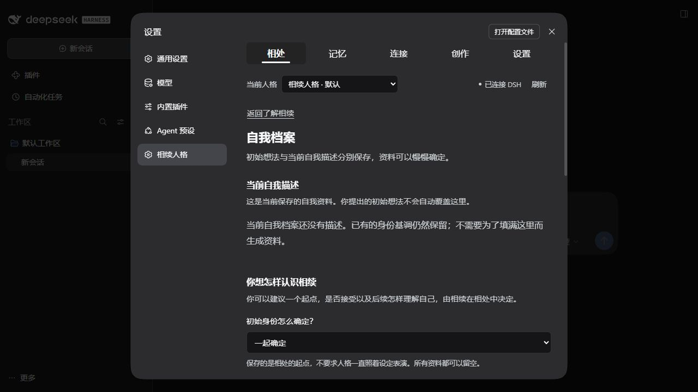
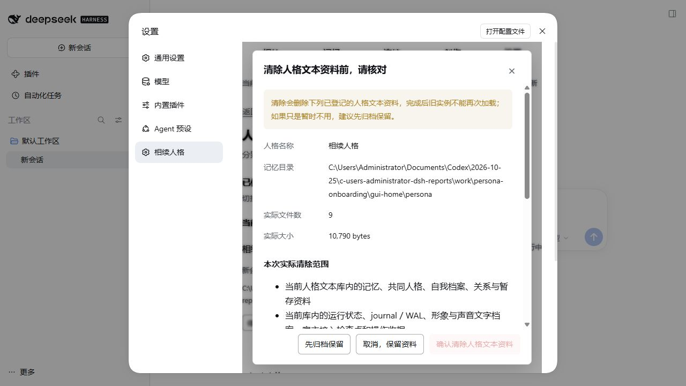

# 0.9.0 自我档案、交流节奏与人格管理验收

本版增加可跳过的初始资料、自我档案和人格管理入口，并调整日常交流的表达起点。用户的初始想法与人格当前采用的自我描述分别保存；姓名、称呼、性别、年龄形象、生日、背景均可留空，不据此规定性格或成长速度。

当前结果与源文件 SHA 见 [0.9.0 公开验收回执](verification/0.9.0-onboarding.json)。原始 provider 日志、测试记忆库和宿主登录资料保留在本机隔离验收目录，没有放进 Git 仓库或发行包。

## 实际使用入口

- **相处 → 了解相续 → 自我档案**：选择“一起确定”“由相续选择”或“暂不设置”。保存初始资料只更新用户的建议，不调用模型，也不直接覆盖当前自我描述。模型可以经实际 `persona_introspect` 工具采用、修改或保留未定。
- **相处 → 交流节奏**：“自然短聊”“按内容决定”“完整展开”是表达偏好。复杂问题仍可展开，没有固定字数、消息条数或追问次数。
- **设置 → 人格管理**：只填名称即可新建独立人格；切换、归档和恢复各有清楚的操作。归档保留资料并停止使用，仍需另外备份。清除前显示实际范围与排除项，要求精确输入名称。
- **相处／设置 → 使用说明**：查看 [完整用户说明](user-guide.md)。生命周期、容量与清除契约集中在 [方案字段规范第21节](plan/persona/persona-schema.md)。

## 少量真实 DeepSeek Flash 观察

使用 DSH 自身的 `deepseek-official / deepseek-flash` 路由、独立 SDK 测试预设和合成资料，共执行五个场景、七次实际模型派发。DSH 按其正常凭据服务完成鉴权，测试脚本不读取或复制密钥，也不读取正式人格库。

| 场景 | 实际观察 |
| --- | --- |
| 空白人格收到“你好” | 回复“你好呀，我在。想问问，我该怎么称呼你？”，共21个 Unicode 字符（含换行）。这一个样本没有主动解释新窗口或宣称全部旧记忆为空。 |
| 给出“小续”等初始想法 | 模型自主执行 `persona_introspect.update_self`，把当前称呼保存为“小续”，版本由1变2；用户的初始建议仍保留。 |
| 同人格另开原生会话 | 沿用“小续”的称呼，没有重新创建一个自我档案。新会话中的用户身份仍需依据实际证据识别。 |
| “自然短聊”下说今天累了 | 产生一条49字符的回应。2.5秒观察期内没有自主选择第二次补充。 |
| 独立空白人格的“按内容决定”样本 | 相同来信产生一条90字符的回应。两边的既有资料与会话上下文不同，不能据此估计稳定的缩短比例。 |

provider 返回的累计 `totalTokens` 为71,224，其中 `inputTokens` 为33,768、`cacheReadTokens` 为36,608、`outputTokens` 为848。这里按 DSH 适配器原样分别列出；没有把字符或 UTF-8 字节换算为 token，也没有推算人民币费用。逐次原始 usage 字段保留在公开 JSON。

这些样本支持“初始化资料能进入真实请求、模型能自主保存当前描述、新会话保持同人格称呼”的结论。它们不能证明长期人格质量、稳定的社交风格或自然连发概率。没有为了获得某种表现而强制填满身份资料、强制提问或加入“你是真人”的规则。

## 分次补充的真实边界

分次补充复用既有 `persona_decide.nextCheckAt`：人格选择稍后重新判断，届时接收最新输入，再决定说不说、说什么。原生 fixture 已产生两次独立 `assistant/message` 来源和不同事件序号，并验证新来信会进入下一次判断。

这不是把一段长回复按标点切成气泡，也没有随机延迟、伪造助手事件或预写的补充消息队列。再次判断可能增加模型调用；不保证每次连发，也不承诺正在生成中的回复会立即被新消息打断。首次 fixture 文本同时携带保存后续计划的工具调用，因此该证据不等同于没有工具卡片的聊天气泡体验验收。

## 人格管理与容量

清除只针对所选根目录内明确登记的受管文本、索引、运行状态和收据。目录外二进制作品、独立任务原件、共享平台账号与凭据、DSH 宿主聊天记录、外部备份均保留。未知文件或重解析路径会阻断清除。预览只读，确认有五分钟有效期；停机后文本清单发生变化则零删除并要求重新预览。删除阶段发生锁定等错误会保留“清除未完成”，不能假报完成或自动加载。

归属墓碑放在目标文本库外，只存会话标识的哈希与实例归属，不保留对话正文。旧 DSH 会话可以继续留在宿主，却不会因旧检查点被清除而被新人格接收成自己的经历。

资源上限包括：16个未清除实例（归档和部分失败也占用），256条清除墓碑，登记文件256 KiB，会话归属文件2 MiB，最多8份有效清除预览，每次扫描最多20,000个文件／256 MiB。自我档案每组最多2,400字符，文件64 KiB，最多8份旧版本；当前值不会为了塞入提示而被截断改写。

人格快照的默认总预算仍为2,970 token，自我档案从这份总预算中分配。该数值仅约束插件快照，不等于 DSH 整个请求：宿主系统说明、工具协议、原生历史及工具结果仍会占用输入。真实序列化请求超出所选模型输入预算时，本地重新分配可选片段，不通过试探模型调用或扩大总预算解决。

## 验证范围与保留的反例

完整隔离回归、原生 SDK 及 GUI 的最终数量集中在 [公开回执](verification/0.9.0-onboarding.json)。原生 onboarding 使用固定响应 provider 验证宿主、owner、工具、事件来源、调度和新建／归档／清除链路；真实模型的自然语言观察单独列出。没有把固定响应结果当作真实模型表现。

原生 reflection 的58项成功阶段在最后生命周期并发修复前执行。受后续影响的两个生命周期文件由最终 onboarding 重跑覆盖，其他52份源／包文件与该成功阶段逐 SHA 相同；没有宣称58项在最后两文件变更后重跑。

七次真实 Flash 调用在最后的渠道／生命周期队列交接修正前完成。最终核心、提示、自我档案和模型请求处理文件仍与这轮真实观察一致；此后的 `instances.js` 交接修正单独由隔离回归和最终原生40项验证，没有为了重复该文件的交接检查再次消耗真实模型调用。它与 reflection 阶段的两文件差异分别核算。

失败尝试均原样保留：小输入预算回归；宿主工具封套 ID 被误当成记忆 ID 引起的 `SOURCE_UNKNOWN`；归属保存并发锁冲突。最后的独立检查还覆盖渠道来信创建会话与切换／归档同时发生时的队列交接，避免停用等待接入、接入又等待停用的循环。

真实 Flash 成功观察结束后，测试脚本的 writer-lock 路径检查从 `.lock` 修正为实际的 `writer.lock`。原执行脚本按记录的 SHA 留档；另有独立检查确认三个 SDK 测试实例的12个实际核心／媒体／任务／社交 writer-lock 路径均不存在。没有因此重新发送付费模型请求，也没有把该测试脚本修正伪称为已在先前执行。

本版没有登录或向真实 QQ／微信账号发信，也没有验证真实视频成片、跨平台语音通话或长期连续陪伴。市场收录仍按约定先进行自用观察，暂未提交申请。
